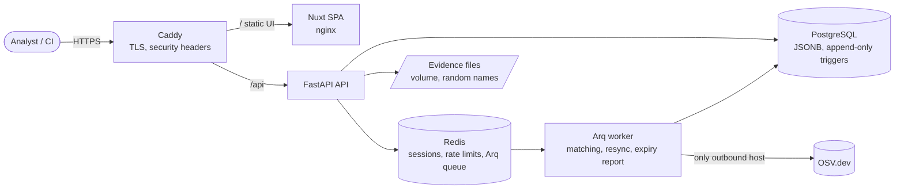
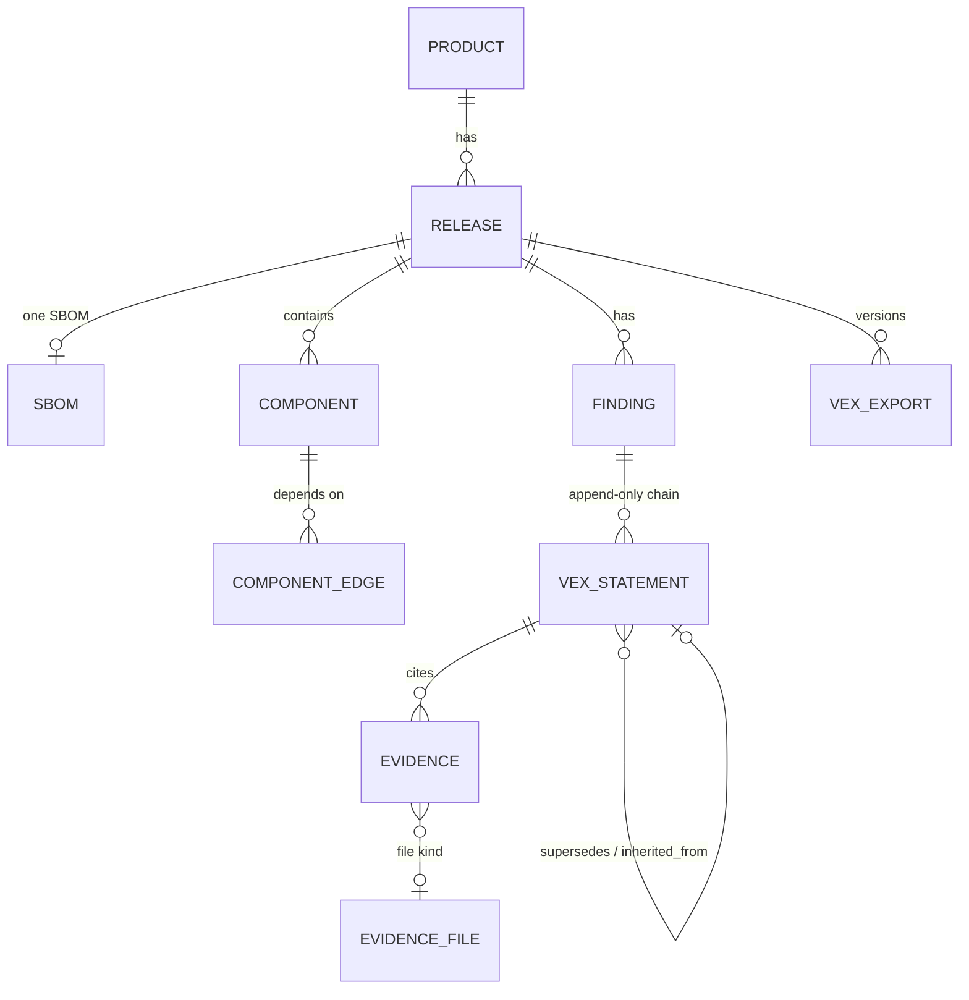
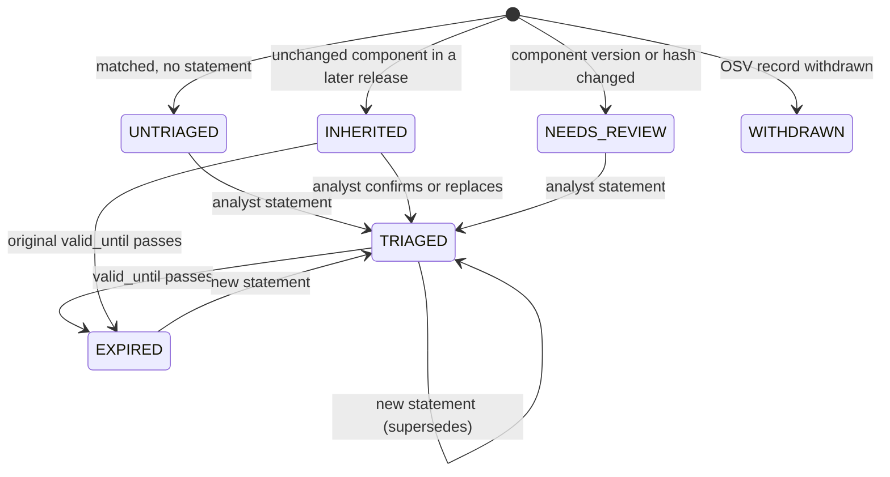
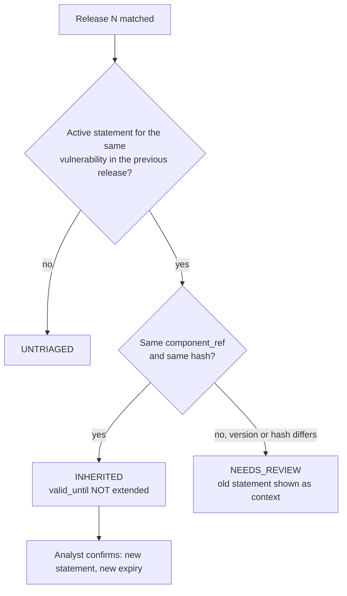

<div align="center">

# VEXLedger

**Triage vulnerabilities once, keep the evidence, and export OpenVEX.**

[](https://github.com/sellebeww/VEXLedger/actions/workflows/ci.yml)

[](LICENSE)


[Features](#features) · [Architecture](#architecture) · [Run it](#run-it) · [CI usage](#using-it-from-ci) · [Threat model](#threat-model) · [Status](#status-per-item)

</div>

---

A lightweight workbench for small teams. Upload a CycloneDX SBOM per release, match components against OSV.dev, then guide analysts through triaging every finding into a VEX statement: status, standard justification, evidence and expiry. Statements are inherited across releases while a component is unchanged, flagged for review when it changes, and exported as an OpenVEX v0.2.0 document.

The focus is the **lifecycle** of a statement (evidence, inheritance, expiry, audit trail), not general component management.

> Version `0.1.0-mvp`. Everything below is checked by tests; what still needs a real environment is listed under [Status](#status-per-item).

## Honest statements

- VEXLedger is an aid for recording triage decisions. It does not decide whether a vulnerability is exploitable; the decision and the responsibility belong to the human analyst.
- There is no compliance guarantee for any regulation (including the EU Cyber Resilience Act). No compliance claim is made anywhere.
- VEX documents produced by the MVP are NOT signed. They are not "verified", "signed", or "attested".
- Matching depends on OSV.dev data, which may be incomplete or late. "No findings" is not proof of "no vulnerabilities".
- Inheritance assumes the application code did not change between releases. Only the component (version and hash) is compared.
- Comparisons with other tools are deliberately absent: none could be verified from their official documentation.

## The problem and its impact

An SBOM lists hundreds of components, a scanner reports dozens of CVEs, and most do not apply to the way a product uses the component. Teams that answer "not affected, because ..." in a ticket, a spreadsheet or a chat lose the answer at the next release: the same questions are asked again, nobody remembers the evidence, and a decision made 18 months ago is trusted without anyone checking that it still holds. The result is repeated work, unreviewed stale decisions, and customers who receive either raw scanner output or nothing.

VEX (Vulnerability Exploitability eXchange) is the standard way to communicate these decisions. VEXLedger records them with the parts that tooling usually skips: who decided, on what evidence, until when, and what changed since.

## Features

1. **CycloneDX import** (JSON, 1.4 to 1.6): purl normalization, dependency graph, components without a valid purl or in an unsupported ecosystem kept and shown (never dropped silently).
2. **OSV matching** with a local cache, periodic re-matching, and a local cross-check that can only raise a flag, never change the result.
3. **Triage queue**: status, five standard justifications, evidence (link, file, note), assignee, expiry, bulk triage.
4. **Append-only statements** with an immutable audit trail enforced by database triggers.
5. **Inheritance and re-review** across releases; expired statements surface again.
6. **Release diff**: components and findings between two releases.
7. **OpenVEX v0.2.0 export** per release with a completeness gate and deterministic, versioned documents.
8. **Local auth**: accounts, API tokens, roles `admin`, `analyst`, `viewer`.
9. **Docker Compose deploy** (Caddy with automatic TLS, API, worker, Postgres, Redis) and GitHub Actions CI for this repository.

The UI is in Indonesian (one central message catalog); code, comments and this README are in English.

## Architecture



The domain logic (purl, version comparison, matching, statement rules, inheritance, diff, OpenVEX builder) lives in `src/vexledger/domain` and is pure: no database, network or clock, so it is tested exhaustively and in isolation.

## Statement data model and state machine



A finding is one vulnerability on one component of one release, identified by `(release, component_ref, canonical vulnerability id)`. All OSV records that alias each other (a `GHSA`, a `PYSEC` and a `CVE` for the same flaw) merge into a single finding; the canonical id is the smallest `CVE-*`, otherwise `GHSA-*`, otherwise another OSV id, and every alias is kept.

A statement is never updated or deleted (database triggers reject `UPDATE`, `DELETE` and `TRUNCATE`). A change is a new row with `supersedes_id`; an inherited statement carries `inherited_from_id`. The state of a finding is derived:



`UNTRIAGED`, `NEEDS_REVIEW` and `EXPIRED` count as open for the export gate; `INHERITED`, `TRIAGED` and `WITHDRAWN` do not. A still-valid `under_investigation` statement counts as `TRIAGED` but is reported separately.

Validation: `not_affected` needs one of the five OpenVEX justifications and an impact statement of at least 20 characters; `affected` needs an action statement; `fixed` needs notes of at least 10 characters; a justification on any other status is rejected; a statement identical to the active one is rejected. Default expiry: `not_affected` 180 days, `under_investigation` 14 days, `affected` and `fixed` none, configurable per product.

## Inheritance and re-review



Inheritance can be switched off per product. Expired statements are not inherited. The hourly worker job only reports the number of expired statements; expiry itself is derived at read time, so no statement row is ever rewritten.

**Assumption to keep in mind:** inheritance compares components, not your own code. If your application changed in a way that makes a previously "not affected" reasoning false, an unchanged dependency will still inherit the old statement. The UI states this assumption in the product settings, next to the inheritance switch.

## Matching and its limits

- **OSV is the authority.** Unique purls (version inside the purl) are sent to `POST /v1/querybatch` in batches of at most 1000; `next_page_token` is followed per query until exhausted (a page with only a token is continued, not treated as clean); details come from `GET /v1/vulns/{id}` and are cached (`vulnerabilities`, `purl_query_cache`, default TTL 6 hours). Retries with backoff for 429 and 5xx, explicit timeouts.
- **Failure is never "0 findings".** If OSV is unreachable, answers are malformed, or OSV lists a record it cannot then provide, the release becomes `MATCH_FAILED` (or stays `MATCH_PENDING`) with a reason, the worker retries, and the export refuses any release that is not `MATCHED`.
- **Supported ecosystems:** PyPI, npm, Maven, Go (purl types `pypi`, `npm`, `maven`, `golang`). Other components are imported and flagged `UNSUPPORTED_ECOSYSTEM`; components without a valid purl or version are flagged `NO_PURL`. Neither is ever matched, and the UI says that their absence from the findings is not a sign of safety.
- **Local cross-check.** A local matcher evaluates OSV `SEMVER` and `ECOSYSTEM` ranges (`GIT` ranges are ignored and noted) with a per-ecosystem comparator: PEP 440 (`packaging`) for PyPI, SemVer for npm and Go (including pseudo-versions), Maven `ComparableVersion` ported from Apache Maven. If it disagrees with OSV, a `match_discrepancy` is stored and counted; OSV always wins. An invalid version yields "unknown", never "affected". The local matcher can never create a finding.
- **Checks on the comparators:** 66 hand-derived cases, 20000 random SemVer pairs against the npm `semver` package, upstream Maven test vectors. The Maven comparator has not yet been compared with the real Java implementation (owner-run script `tools/maven_differential.py`).
- **Severity** is copied from OSV as information only and never drives a VEX status.

## Run it

Requirements: Python 3.14, [uv](https://docs.astral.sh/uv/), Node 24 (see `web/.nvmrc`), Docker.

Owner demo, from zero, with SYNTHETIC vulnerability data and no internet (the SBOM is real `cyclonedx-py` output, the OSV records are invented and say so):

```sh
make demo                           # fresh database, API, worker, scripted walkthrough
(cd web && npm ci && npm run dev)   # then log in as admin (see docs/DEMO.md)
```

Development:

```sh
cp .env.example .env
uv sync
make dev-up        # Postgres + Redis (host ports 5433 / 6380)
make migrate
uv run uvicorn vexledger.api.app:create_app --factory --reload
uv run python -m vexledger.worker
(cd web && npm ci && npm run dev)
make verify        # ruff, mypy --strict, pytest with coverage, web lint, typecheck, tests, build
```

Production: Docker Compose behind Caddy with automatic TLS, see `docs/DEPLOY.md`. `deploy/smoke.sh` builds the images, starts the stack with throwaway secrets and runs the whole demo through it.

## Using it from CI

Create an analyst API token in the admin page (shown once, stored only as a hash), keep it as a CI secret, then:

```sh
R="$VEX/api/v1/products/$P/releases"; H="Authorization: Bearer $TOKEN"
curl -sS -X POST "$R" -H "$H" -H 'Content-Type: application/json' -d "{\"version\": \"$V\"}"
curl -sS --fail-with-body -X POST "$R/$V/sbom" -H "$H" -F "file=@bom.cdx.json;type=application/json"
until s=$(curl -sS "$R/$V/match-status" -H "$H" | jq -r .status); [ "$s" != MATCH_PENDING ]; do sleep 10; done
[ "$s" = MATCHED ] || exit 1
curl -sS "$R/$V/gate" -H "$H" | jq -e '.complete' >/dev/null      # fail the build while findings are open
curl -sS --fail-with-body -X POST "$R/$V/export" -H "$H" -o "vex-$P-$V.json"
```

The full reference, error codes and the endpoint matrix are in `docs/API.md` (also served as OpenAPI at `/docs`).

## Threat model

Inputs from outside are untrusted: SBOMs, purls, analyst text, evidence files and file names, and OSV responses.

| Concern | Control |
|---|---|
| Hostile SBOM | JSON only (no XML, so no XXE), 25 MB default cap checked before reading, depth and component limits, schema validation per declared version; rejected uploads write nothing |
| Hostile text in the UI | Escaped by default, no `v-html` (lint rule), analyst text shown as plain text, evidence links only `http`/`https` with `rel="noopener noreferrer"` and never fetched by the server, CSP on the UI |
| Evidence files | Real content checked against the type, random stored names, SHA-256 recorded, served only as `Content-Disposition: attachment` with `nosniff`, 10 MB cap |
| Access | Argon2id, 12 character minimum, HttpOnly + SameSite=Lax (+ Secure in production) session cookies, CSRF token on every session mutation, login rate limits per account and per IP, personal API tokens stored as SHA-256 hashes and creatable only from a login session, three roles, an authorization matrix test that fails when a route is not listed |
| Outbound traffic | OSV is the only outbound host and is fixed by configuration, never taken from input |
| Tampering | `vex_statements`, `evidence`, `evidence_files`, `vex_exports` and `audit_log` reject `UPDATE`, `DELETE`, `TRUNCATE` in the database; every mutation writes an audit row |
| Outages | PostgreSQL or Redis down gives a clear 503 and fails closed |
| Containers | Non-root, read-only root filesystem, no capabilities, only Caddy publishes ports |

Honest limits:

- **Exported documents are not signed.** Anyone who can alter the file can alter the claims; the content hash and version help detect changes only if you store them elsewhere.
- **OSV is a single point of dependence.** If OSV omits or delays an advisory, VEXLedger will too.
- **Inheritance assumes unchanged application code** (see above).
- **The database owner is trusted.** The append-only guarantee is enforced by triggers; a superuser or the table owner can disable them. Use a separate low-privilege role for the application in a hardened deployment and back up the audit log.
- **Local accounts only.** No SSO, no 2FA, no per-organization isolation; login rate limiting trusts the client address forwarded by Caddy.
- **Demo mode** (`DEMO_OSV_FIXTURES=1`) replaces OSV with invented data and must never be enabled together with real data; the UI shows a banner while it is on.
- The findings list loads all findings of a release and sorts them in memory; fine for thousands, a known limit beyond tens of thousands.

## Status per item

| # | Mandatory item | Status |
|---|---|---|
| 1 | CycloneDX import | tested with real SBOMs 1.4 to 1.6; a real npm SBOM has not been generated |
| 2 | OSV matching, cache, re-match | tested with a fake OSV and real Postgres/Redis; real OSV at scale needs an environment test |
| 3 | Triage queue | tested end to end (API and UI) |
| 4 | Append-only statements and audit | tested (psql, ORM, API) |
| 5 | Inheritance and re-review | tested, including a three-release chain |
| 6 | Release diff | tested (API and UI) |
| 7 | OpenVEX export | checked against the official v0.2.0 JSON schema; `vexctl` has not been run |
| 8 | Local auth | tested |
| 9 | Compose deploy and CI | Compose smoke test passes; the GitHub Actions workflow has not yet run on GitHub |

Everything that still needs a real environment is in `docs/ENV_TEST.md`: Maven comparator against Java, real OSV at scale, `vexctl`, a public VPS, the CSP through Caddy in a browser, a full accessibility tool run, and the CI run itself. Other documents: `docs/DEPLOY.md`, `docs/API.md`, `docs/VERSION_TESTS.md`.

## License and owner

MIT License. Copyright (c) 2026 Vassel Goleyu. See [LICENSE](LICENSE).
